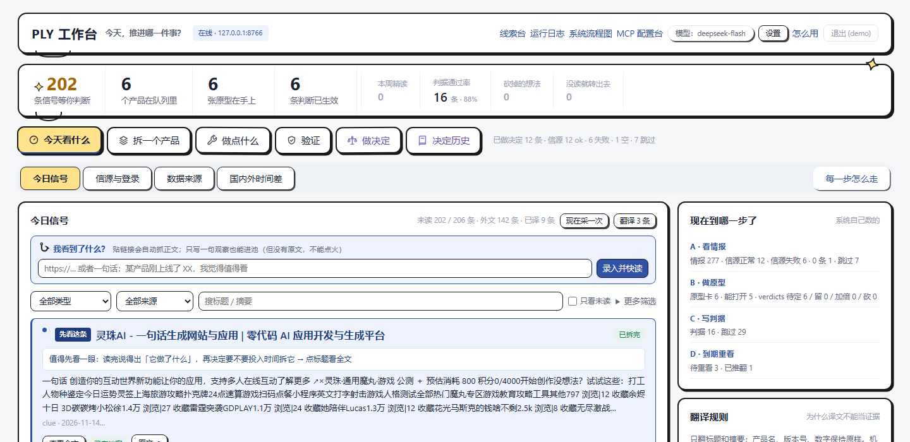
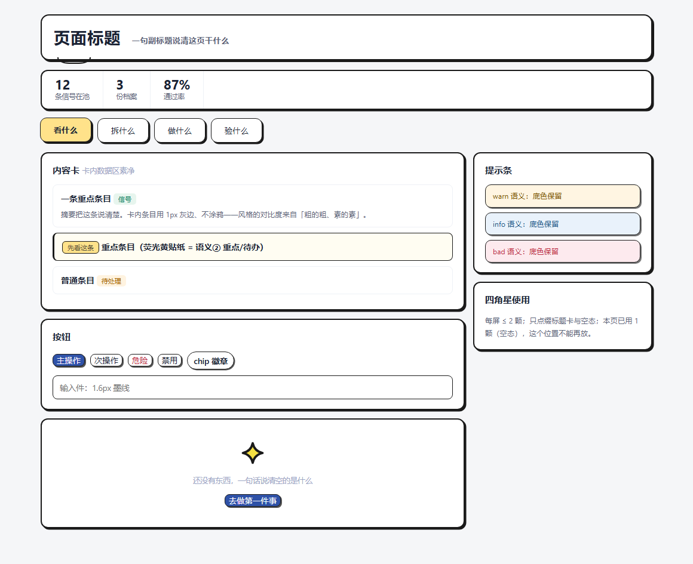

# doodle-card-ui · 手绘贴纸卡片风设计系统 / Hand-drawn Sticker Card Design System

**中文** | [English](en/README.md)

> 效果预览 / Preview（截自 pm-os 工作台真实落地页）
>
> 
>
> 

一套经真实项目验证的 Web UI 风格系统（Agent Skill 格式）：白色圆角卡片 + 深墨线描边 + 右下硬投影（贴纸感）+ 荧光黄点缀 + 手绘涂鸦 SVG。

> 出身：在 pm-os AI PM 工作台（7 个页面）经 14 轮真实迭代沉淀而来——每一条数值、每一条踩坑都来自落地代码，不是理论推演。

A battle-tested Web UI style system in Agent Skill format: white rounded cards + dark ink outlines + bottom-right hard shadows (sticker feel) + fluorescent-yellow accents + hand-drawn doodle SVGs.

> Provenance: distilled from 14 real iteration rounds across 7 pages of the pm-os AI PM workbench — every value and every pitfall comes from shipped code, not theory.

## 特点 / Highlights

- **零依赖 / Zero dependencies** — 纯 CSS + 内联 SVG / pure CSS + inline SVG
- **可增量覆盖 / Incremental** — 不改既有 DOM 与样式，追加覆盖块即可 / append override blocks without touching existing DOM
- **有语义铁律 / Semantic iron rules** — 荧光黄与四角星不是随便用的 / fluorescent yellow & stars are not free decorations

## 快速开始 / Quick start

1. 读规则：读 [`assets/doodle.css`](assets/doodle.css)（token + 组件配方）+ [`references/style-spec.md`](references/style-spec.md)（规格 + 踩坑）——代码即真相，规格是精确数值 / Read the rules: `doodle.css` (tokens + recipes) + `style-spec.md` (specs + scars) — code is the source of truth
2. 从零建页：拷 [`assets/doodle-page-template.html`](assets/doodle-page-template.html) 起步 / New page: start from the template
3. 存量改造：把 `doodle.css` 追加到页面样式**末尾**，按组件层分批覆盖 / Existing page: append `doodle.css` at the END of styles, override layer by layer
4. 验收：computed style 断言（border / box-shadow / 背景）为主；需要目视确认时可选看[基准截图](references/screenshots.md) / Accept: computed-style assertions first; optional visual check against [baseline screenshots](references/screenshots.md)

## 目录结构 / Structure

```
├── SKILL.md                  # 唯一技能入口（中文主文档：工作流 + 铁律 + 踩坑速查）
├── en/
│   ├── README.md             # 英文门面页（含预览图）/ English storefront (with preview images)
│   └── SKILL_EN.md           # English mirror (reference only, no frontmatter — not a separate skill)
├── assets/
│   ├── doodle.css            # 设计系统 CSS（token + 组件配方）/ design-system CSS (tokens + recipes)
│   ├── doodle-page-template.html  # 组件模板页（起点样板）/ component template page (starting boilerplate)
│   └── doodle-library.html   # 8 个成品涂鸦 SVG / 8 finished doodle SVG pieces
├── references/
│   ├── style-spec.md         # 完整规格 + 10 条实战踩坑 / full specs + 10 battle scars
│   ├── svg-prompt.md         # 涂鸦 SVG 生成 prompt 模板 / doodle SVG generation prompt templates
│   ├── screenshots.md        # 视觉基准索引 / visual baseline index
│   └── screenshots/          # 真实落地页截图 / real shipped-page baselines
└── en/references/            # English mirrors of all references
```

## 语义铁律 / Semantic iron rules（不可协商 / non-negotiable）

1. **荧光黄 `#ffe28a` 三种语义 / Fluorescent yellow, three meanings only**：选中态 / selected · 待办计数 / to-do count · 人工闸门 / human gate
2. **四角星每屏 ≤ 2 颗 / Stars ≤ 2 per screen**
3. **粗墨线只上一级容器 / Thick ink on top-level containers only** —— 表格、日志、代码区保持素净 / tables, logs and code areas stay plain

## 使用方式 / How to use

作为 WorkBuddy/Claude 类 Agent Skill 安装到 `~/.workbuddy/skills/doodle-card-ui/`，根目录 `SKILL.md` 是唯一入口；英文版 `en/SKILL_EN.md` 为参考镜像，无 frontmatter、不会被注册为独立技能。也可以不当 skill 用——直接把 `assets/` 当设计系统拷进任何 Web 项目。

Install as an agent skill under `~/.workbuddy/skills/doodle-card-ui/`; the root `SKILL.md` is the single entry point. The English `en/SKILL_EN.md` is a reference mirror with no frontmatter and is not registered as a separate skill. Or skip the skill form entirely — copy `assets/` into any web project as a standalone design system.

## License / 许可

MIT
