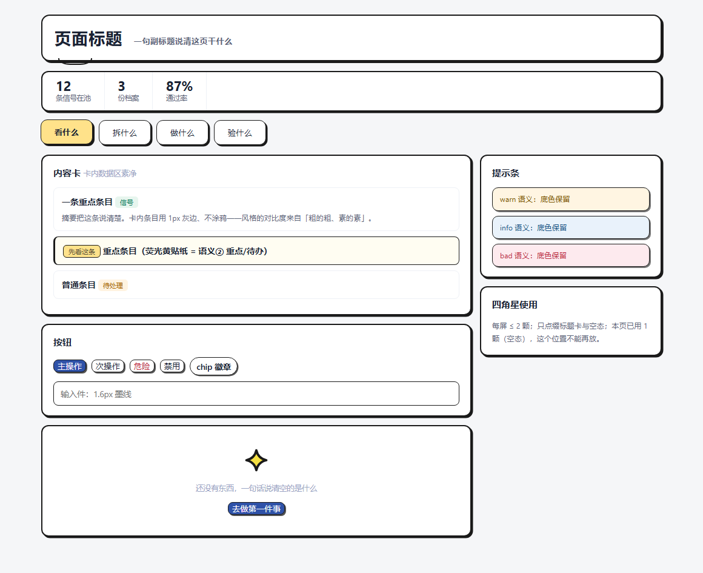

# doodle-card-ui · Hand-drawn Sticker Card Design System

[中文](../README.md) | **English**

> Preview (captured from real shipped pages of the pm-os workbench)
>
> 
>
> 

A battle-tested Web UI style system in Agent Skill format: white rounded cards + dark ink outlines + bottom-right hard shadows (sticker feel) + fluorescent-yellow accents + hand-drawn doodle SVGs.

> Provenance: distilled from 14 real iteration rounds across 7 pages of the pm-os AI PM workbench — every value and every pitfall comes from shipped code, not theory.

## Highlights

- **Zero dependencies** — pure CSS + inline SVG
- **Incremental** — append override blocks without touching existing DOM or styles
- **Semantic iron rules** — fluorescent yellow & four-pointed stars are not free decorations

## Quick start

1. Read the rules: [`doodle.css`](../assets/doodle.css) (tokens + component recipes) + [`style-spec.md`](../references/style-spec.md) (specs + scars) — code is the source of truth
2. New page: start from [`doodle-page-template.html`](../assets/doodle-page-template.html)
3. Existing page: append `doodle.css` at the END of styles, override layer by layer
4. Accept: computed-style assertions first; optional visual check against [baseline screenshots](../references/screenshots.md)

## Structure

```
├── SKILL.md              # the single skill entry point (Chinese main doc)
├── en/
│   ├── README.md         # this English storefront (with preview images)
│   ├── SKILL_EN.md       # English mirror of SKILL.md (reference only, no frontmatter)
│   └── references/       # English mirrors of the references
├── assets/
│   ├── doodle.css        # design-system CSS (tokens + recipes)
│   ├── doodle-page-template.html  # component template page (starting boilerplate)
│   └── doodle-library.html  # 8 finished doodle SVG pieces
└── references/
    ├── style-spec.md     # full specs + 10 battle scars
    ├── svg-prompt.md     # doodle SVG generation prompt templates
    ├── screenshots.md    # optional visual baseline index
    └── screenshots/      # real shipped-page baselines
```

## Semantic iron rules (non-negotiable)

1. **Fluorescent yellow `#ffe28a`, three meanings only**: selected state · to-do count · human gate
2. **Stars ≤ 2 per screen**
3. **Thick ink on top-level containers only** — tables, logs and code areas stay plain

## How to use

Install as an agent skill under `~/.workbuddy/skills/doodle-card-ui/`; the root `SKILL.md` is the single entry point. The English `SKILL_EN.md` is a reference mirror with no frontmatter and is not registered as a separate skill. Or skip the skill form entirely — copy `assets/` into any web project as a standalone design system.

## License

MIT
